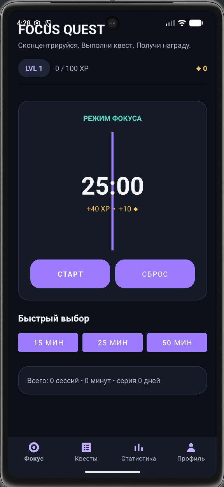
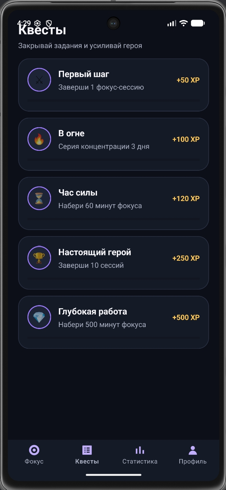
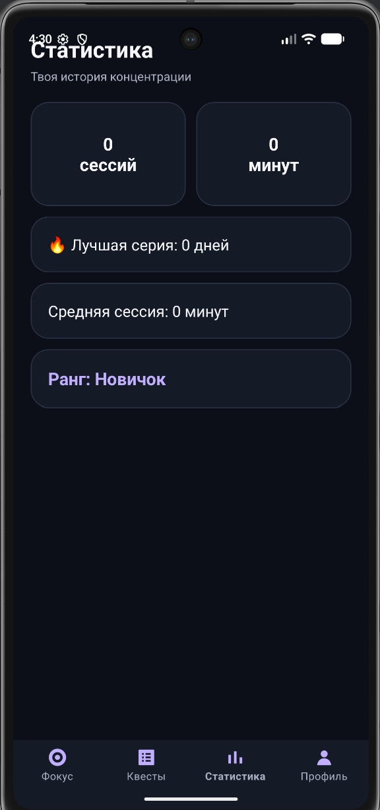

# FocusQuest

**FocusQuest** — Android-приложение для концентрации и Pomodoro с RPG-прогрессией.

Пользователь запускает фокус-сессию, завершает её как игровой квест и получает XP и монеты. По мере работы повышается уровень героя, открываются новые ранги и выполняются достижения.

## Возможности

- Pomodoro / фокус-таймер на 15, 25 и 50 минут;
- пауза и сброс таймера;
- XP, монеты и уровни;
- серия дней концентрации;
- игровые квесты и прогресс достижений;
- статистика сессий и времени;
- профиль героя и ранги;
- локальное хранение данных через Room;
- тёмный RPG-интерфейс;
- интерфейс полностью на XML, без Jetpack Compose.
  ## Скриншоты

  
  
  
  

## Стек

- Kotlin
- XML Layouts
- MVVM
- ViewBinding
- Room Database
- Coroutines / Flow
- RecyclerView
- Material Components

